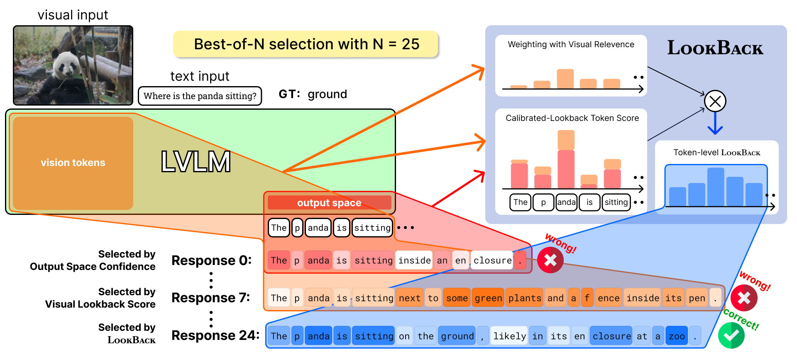

<h1 align="center"> LookBack: Where and How to Score LVLM Responses via Visual Reference Usage
</h1>

[](https://arxiv.org/abs/2608.11847)&nbsp;
[](https://huggingface.co/papers/2608.11847)&nbsp;
[](LICENSE)

<div align="center">
  <a href="https://bscho333.notion.site/" target="_blank">Beomsik&nbsp;Cho</a><sup>1*</sup> &ensp; <b>&middot;</b> &ensp;
  Jinhyeong&nbsp;Kim<sup>1*</sup> &ensp; <b>&middot;</b> &ensp;
  Dongseok&nbsp;Lee<sup>1</sup> &ensp; <b>&middot;</b> &ensp;
  <a href="https://sites.google.com/view/jaehyungkim" target="_blank">Jaehyung&nbsp;Kim</a><sup>1</sup> &ensp; <br>
  <sup>1</sup> Yonsei University &emsp; <sup>*</sup> Equal contribution
</div>
<br>

## Overview

<p align="center">
  
</p>

**LookBack** is a training-free response scoring method for LVLMs that uses **visual reference usage** to guide Best-of-N selection. It calibrates token likelihoods with a visual lookback score that measures how strongly each prediction step attends to vision tokens. Since not all tokens are equally informative about visual grounding, LookBack gives greater weight to tokens that refer more strongly to visual evidence when aggregating the calibrated scores. It uses the model's own logits and attention without requiring an external reward model or additional training.

We provide Qwen2.5-VL-7B-Instruct and InternVL3-8B implementations, with CHAIR evaluation.

## Setup

```bash
conda create -n lookback python=3.10 -y
conda activate lookback
pip install -r requirements.txt
python -m nltk.downloader punkt_tab averaged_perceptron_tagger_eng wordnet
```

The default checkpoints are [Qwen2.5-VL-7B-Instruct](https://huggingface.co/Qwen/Qwen2.5-VL-7B-Instruct)
and [InternVL3-8B](https://huggingface.co/OpenGVLab/InternVL3-8B).
To use local weights, pass `--model_path` to the Python script.
InternVL uses the checkpoint's original model code via `trust_remote_code=True`.

For CHAIR, prepare [COCO 2014](https://cocodataset.org/#download):

```text
data/coco/
├── val2014/
└── annotations/
    ├── instances_train2014.json
    ├── instances_val2014.json
    ├── captions_train2014.json
    └── captions_val2014.json
```

## Generation + LookBack + CHAIR evaluation

Set `coco_path` in `scripts/generate.sh`, then run from the repository root:

```bash
bash scripts/generate.sh qwen
# or
bash scripts/generate.sh internvl
```

This generates 5 candidates per image for 500 images, with `max_new_tokens=512`,
temperature 1.2, top-p 0.95, and seed 42. Edit these settings in the shell script
or pass the corresponding arguments to `generate.py`. For 1,000 images with
32 candidates each, set `--num_eval_samples 1000 --N 32`.

## LookBack on existing BoN responses

Provide a JSON list with image paths, queries, and candidate responses:

```json
[
  {
    "id": 1,
    "image_path": "/path/to/image.jpg",
    "query": "Please describe this image in detail.",
    "responses": ["A dog is sitting on the grass.", "A cat is sitting on the grass."]
  }
]
```

```bash
bash scripts/rerank.sh qwen /path/to/bon.json
# or
bash scripts/rerank.sh internvl /path/to/bon.json
```

`rerank.py` is benchmark-independent: it only uses `image_path`, `query`, and
`responses`. The output adds `scores`, `selected_index`, and `selected_response` and is saved
to `output/<model>/scored.json`.

To use our provided CHAIR evaluation, `id` must be the numeric COCO image ID. Evaluate selected responses with:

```bash
python evaluate.py --input_file output/qwen/scored.json \
  --anno_path data/coco/annotations --output_file output/qwen/result.json
```

## Code

```text
generate.py             CHAIR generation and LookBack scoring
rerank.py               LookBack scoring of an existing BoN JSON file
evaluate.py             CHAIR evaluation
lookback.py             LookBack score
models/                 Qwen and InternVL
benchmarks/chair.py      COCO data loading
benchmarks/src/chair.py  CHAIR evaluator with F1
scripts/generate.sh      Generation, scoring, and CHAIR evaluation
scripts/rerank.sh        Scoring existing responses
```

## Acknowledgements

This repository builds on [Qwen2.5-VL](https://github.com/QwenLM/Qwen2.5-VL),
[InternVL](https://github.com/OpenGVLab/InternVL),
[CHAIR](https://github.com/LisaAnne/Hallucination), and
[ReVisiT](https://github.com/bscho333/ReVisiT).

## Citation

```bibtex
@inproceedings{cho2026lookback,
  title     = {{LookBack}: Where and How to Score {LVLM} Responses via Visual Reference Usage},
  author    = {Cho, Beomsik and Kim, Jinhyeong and Lee, Dongseok and Kim, Jaehyung},
  booktitle = {Findings of the Association for Computational Linguistics: EMNLP 2026},
  year      = {2026},
  url       = {https://arxiv.org/abs/2608.11847}
}
```
